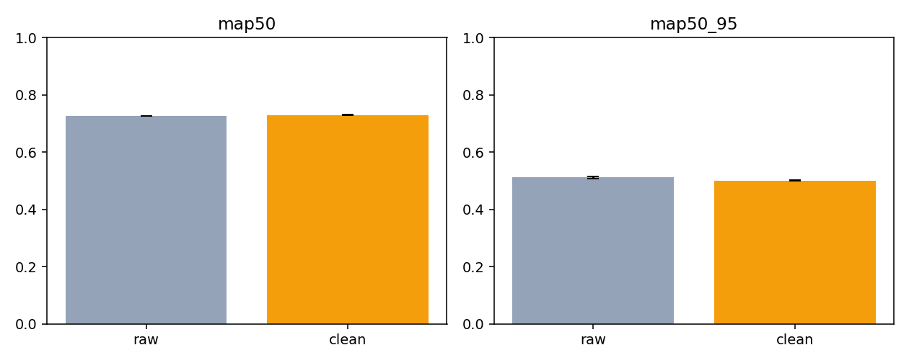

# Báo cáo Day 09 — Pham Van Duong, 2A202603332

> Số liệu lấy từ `submission/reports/`, calibration và kết quả chạy pipeline.

## 1. Kết luận trước
**Hold**. Pipeline quét 224 ảnh; 31 ảnh bị loại ở intake, còn 193 ảnh xử lý và xuất bản nháp 193 nhãn tại `submission/export/clean_v1/`. Sau sửa tự động còn 6 ảnh thiếu file nhãn bắt buộc, nhưng mô phỏng người duyệt đã xử lý chúng; vẫn còn 34/193 ảnh (17.62%) có cảnh báo chưa duyệt nên đạt ngưỡng Hold 10%, không phải Release.

## 2. Lỗi và phân việc
Các mã theo ảnh ghi số ảnh duy nhất bị ảnh hưởng. Intake dùng mẫu số 224 ảnh đầu vào; QC sau intake dùng 193 ảnh còn lại. Các mã theo dòng nhãn dùng 644 dòng nhãn không trống được kiểm tra ở vòng QC đầu, trước autofix: 187 file nhãn của 193 ảnh sau intake (6 ảnh không có file nhãn).

| Mã lỗi | Số ảnh/dòng (kèm mẫu số) | Ai sửa (máy/người) | Vì sao |
|---|---:|---|---|
| `POSSIBLE_MISSING` | 52/193 ảnh (53 cảnh báo) | người | Model phát hiện vật chưa có nhãn; máy không được bịa nhãn. |
| `POSSIBLE_FALSE_POS` | 26/193 ảnh (28 cảnh báo) | người | Box nhãn không khớp dự đoán model; cần nhìn ảnh. |
| `POSSIBLE_LOOSE_BOX` | 23/193 ảnh (27 cảnh báo) | người | Box có thể lệch nhẹ hoặc sai vật; máy không sửa ngữ nghĩa. |
| `POSSIBLE_WRONG_CLASS` | 17/193 ảnh | người | Model và nhãn trái lớp; cần xác nhận đúng lớp. |
| `EMPTY_LABEL` | 11/193 ảnh | người | File rỗng có thể là ảnh nền hoặc thiếu nhãn. |
| `LEAK_TEST` | 11/224 ảnh đầu vào | máy | Loại khỏi bộ train vì trùng ảnh trong kho test/val. |
| `BOX_OUT_OF_IMAGE` | 8/644 dòng nhãn | máy | Cắt box hoặc bỏ dòng nếu box mất diện tích. |
| `DUP_IMAGE_EXACT` | 8/224 ảnh đầu vào | máy | Trùng từng byte nên loại ảnh trùng. |
| `DUP_BOX` | 7/644 dòng nhãn | máy | Bỏ dòng trùng trong file nhãn. |
| `DUP_IMAGE_NEAR` | 7/224 ảnh đầu vào | máy | Trùng gần đúng theo pHash với ngưỡng đã calibrate. |
| `BAD_CLASS_ID` | 6/644 dòng nhãn | máy | ID ngoài 0–3 bị loại an toàn. |
| `MISSING_LABEL_FILE` | 6/193 ảnh | người | Không tạo file rỗng; ảnh được ưu tiên lên hàng đợi. |
| `BOX_TINY` / `BOX_HUGE` | 4/193 ảnh (6 box) / 3/193 ảnh | người | Cảnh báo kích thước; máy chỉ ghi cảnh báo. |
| `BOX_ZERO` | 4/644 dòng nhãn | máy | Cạnh không dương làm box vô hiệu. |
| `BAD_FORMAT` | 3/644 dòng nhãn | máy | Dòng không đủ 5 cột/số hợp lệ bị xoá. |
| `BAD_SIZE` | 3/224 ảnh đầu vào | máy | Cạnh ngắn dưới 250 px bị loại ở intake. |
| `CORRUPT_IMAGE` | 2/224 ảnh đầu vào | máy | Ảnh không mở được hoặc hỏng. |
| `BAD_CLASS_NAME` | 2 tên lớp sai/1 dataset | máy | Ghi lại `names` thành `car, person, truck, bus`. |
| `CLASS_RARE` | 4 lớp hiếm/1 dataset | người | Lớp hiếm cần xem phân bố, không suy ra nhãn sai. |

Hàng đợi ưu tiên 6 ảnh `NEEDS_LABEL` với trọng số 10.0, sau đó là ảnh chồng nhiều cảnh báo hoặc fix quan trọng, ví dụ `img_0020` có điểm 11.524. Ngân sách là 80/121 ảnh cần người xem; 80 ảnh đầu hàng đã được mô phỏng duyệt và 41 ảnh còn lại chưa được duyệt.

## 3. Calibration (2 ngưỡng)
| Tham số | Khởi đầu | Đã chọn | Precision / Recall (trước → sau) | Lý do (đánh đổi) |
|---|---|---|---|---|
| `duplicates.phash_dist` | 2 | 16 | DUP_IMAGE_NEAR: 1.00/0.50 → 1.00/0.83 | Tăng recall gần trùng từ 50% lên 83% mà vẫn giữ precision 1.00. Ở ngưỡng 20, recall theo mã `DUP_IMAGE_EXACT` còn 0.33 vì 2/3 mẫu trùng exact bị gán thành `LEAK_TEST` trước khi kiểm tra exact; đây là đổi loại cảnh báo do thứ tự ưu tiên, không phải exact matching tự yếu đi. |
| `second_opinion.conf` | 0.25 | 0.60 | WRONG_CLASS: 0.56/0.83 → 0.62/0.83; MISSING: 0.50/1.00 → 0.57/1.00 | Giữ recall missing 100%, tăng precision wrong-class và missing; tránh hạ ngưỡng quá thấp làm nhiều cảnh báo giả. |

Điểm calibration dễ đánh lừa: bộ calib chỉ có 39 ảnh. Ngưỡng pHash 16 bắt 5/6 near-duplicate trong calib, nhưng trên raw có thể coi ảnh khác nhau là trùng nếu cảnh đổi trộn hoặc nền giống; trong kết quả intake có 31 ảnh bị loại và cần mở xem mẫu trước phát hành. Ngưỡng model 0.60 giảm FP ở calib nhưng vẫn có false-positive cảnh báo do model lớn hơn chưa chắc là đúng.

## 4. Cửa chặn và điều pipeline KHÔNG bắt được
Gate đã được chứng minh bằng:
`python -m pipeline.run --budget 0 --reports work/rep_nb --export-dir work/exp_nb`.
Không có người duyệt nên 6 ảnh `MISSING_LABEL_FILE` còn nguyên; kết luận **Rework**, mã thoát 20 và pipeline không xuất dataset tại `work/exp_nb`.

Hai điểm pipeline không bắt chắc:
1. Box lỏng nhẹ hoặc sai khác mức mà model cũng có thể nhầm; calibration cho thấy `POSSIBLE_LOOSE_BOX` recall/thống kê còn thấp.
2. Nhầm lớp, vật che khuất hoặc ảnh trùng biến đổi mạnh có thể vượt quy tắc máy; model checker chỉ là ý kiến thứ hai, không thay thế người duyệt.

## 5. Train: Raw vs Clean (tùy chọn, chấm riêng)

Thực nghiệm so sánh hai biến thể dữ liệu Raw và Clean bằng mô hình YOLO26n. Mỗi biến thể chạy với 2 seed (0 và 1), cùng cấu hình huấn luyện: 20 epochs, image size 640, batch size 16, sử dụng GPU Tesla T4. Cả hai biến thể được đánh giá trên cùng tập test gồm 100 ảnh và 387 đối tượng.

### 5.1. Kết quả so sánh

| Biến thể | Ảnh trong thư mục train | Ảnh thực tế dùng train | Số seed | mAP50 (TB ± độ lệch) | mAP50-95 (TB ± độ lệch) | Precision (TB ± độ lệch) | Recall (TB ± độ lệch) |
|---|---:|---:|---:|---:|---:|---:|---:|
| Raw | 224 | 213 | 2 | 0.726 ± 0.000 | 0.512 ± 0.004 | 0.764 ± 0.061 | 0.649 ± 0.028 |
| Clean | 193 | 193 | 2 | 0.730 ± 0.001 | 0.501 ± 0.001 | 0.800 ± 0.019 | 0.624 ± 0.012 |

**Lưu ý về dữ liệu:** Raw có 224 ảnh trong thư mục nhưng Ultralytics phát hiện 11 ảnh lỗi và bỏ qua chúng, nên thực tế sử dụng 213 ảnh để huấn luyện. Clean có 193 ảnh và cả 193 ảnh đều được sử dụng.

### 5.2. Biểu đồ so sánh

Biểu đồ được lưu tại `submission/results/comparison.png`.

### 5.3. Nhận xét

- **mAP50:** Clean đạt 0.730, cao hơn Raw (0.726), chênh lệch khoảng +0.004.
- **mAP50-95:** Raw đạt 0.512, cao hơn Clean (0.501).
- **Precision:** Clean đạt 0.800, cao hơn Raw (0.764).
- **Recall:** Raw đạt 0.649, cao hơn Clean (0.624).

Kết quả cho thấy Clean có mAP50 và Precision nhỉnh hơn, trong khi Raw có mAP50-95 và Recall cao hơn. Vì vậy, chưa thể kết luận Clean tốt hơn Raw trên mọi tiêu chí. Chênh lệch mAP50 cũng tương đối nhỏ.

Thực nghiệm chỉ sử dụng 2 seed và 20 epochs trên bộ dữ liệu có quy mô hạn chế, do đó kết quả mang tính tham khảo trong phạm vi bài lab, chưa đủ để khẳng định ưu thế tổng quát của một biến thể dữ liệu.

## 6. Quyết định và ghi chú AI
Quyết định cuối là **Hold**. Hàng đợi có 121 ảnh: mô phỏng đã duyệt 80 ảnh, còn 41 ảnh chưa duyệt. Sáu ảnh thiếu file nhãn đã được duyệt và thay nhãn theo `06_review_log.csv`, nên không còn là việc chờ xử lý. Sau khi bỏ qua cảnh báo trên ảnh đã duyệt, gate vẫn tính 34/193 ảnh chưa duyệt còn cảnh báo (17.62%). Để đạt Release, cần xử lý đủ cảnh báo để còn tối đa 19/193 ảnh (dưới 10%) và không còn lỗi bắt buộc.

**Dùng AI:** prompt chính yêu cầu implement đúng docstring và 4 module theo test. Kiểm tra bằng chạy từng test module, toàn bộ `pytest`, pipeline thật và trường hợp budget 0. Một lần AI sai là bản autofix đầu tiên có thể dịch sai dòng gốc khi vừa xoá rồi mới cắt box; đã sửa bằng xử lý drop/clip theo số dòng gốc giảm dần và chạy lại test.
